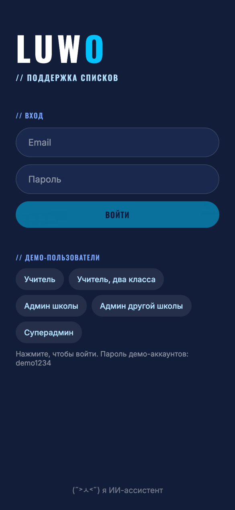
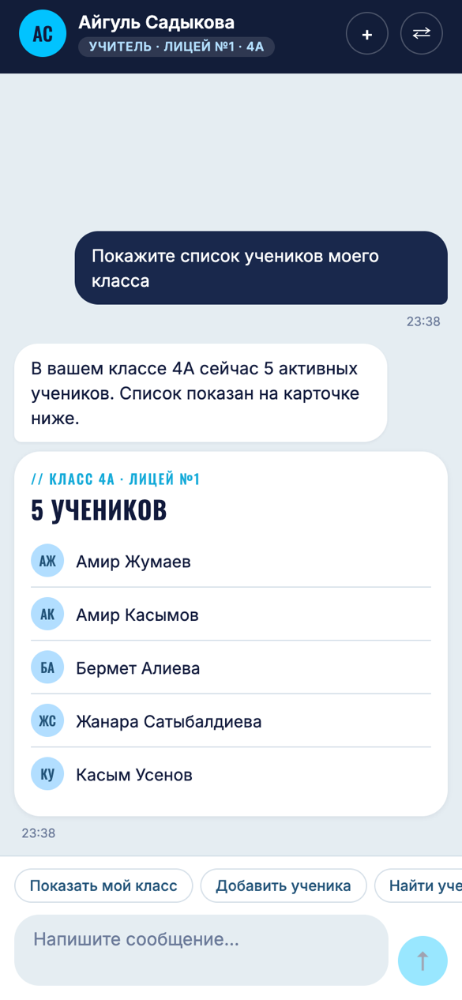
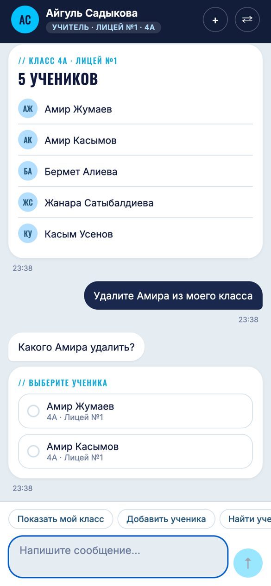
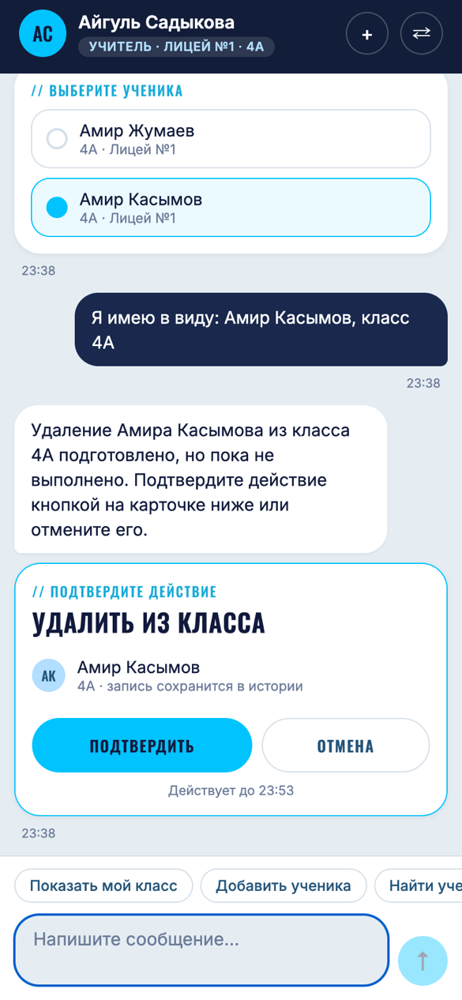

# Мобильное приложение (Expo, React Native, TypeScript)

Чат с агентом поддержки списков. Всё взаимодействие идёт через чат: история сообщений, карточки
(список класса, учителя, ученик, «куда пропал ученик»), выбор ученика из нескольких, подтверждение
изменений кнопками, понятные сообщения об успехе и ошибках. Дизайн взят с luwo.ai (цвета navy и cyan,
шрифты Oswald и Inter, закруглённые «таблетки»).

 
 

## Запуск

Сначала запустите backend (из корня репозитория, см. главный README):

```bash
uvicorn app.main:app --host 0.0.0.0 --port 8000
```

Затем приложение:

```bash
cd mobile
npm install
cp .env.example .env        # адрес backend, см. ниже
npx expo start
```

В терминале: `i` открывает iOS-симулятор, `a` — Android-эмулятор, `w` — браузер. На телефоне:
установите **Expo Go** и отсканируйте QR-код (телефон и компьютер в одной Wi-Fi сети).

**Адрес backend** задаётся в `mobile/.env`:

| Где запущено приложение | `EXPO_PUBLIC_API_URL` |
|---|---|
| iOS-симулятор, браузер | `http://localhost:8000` |
| Android-эмулятор | `http://10.0.2.2:8000` |
| Телефон с Expo Go | `http://<адрес компьютера в сети>:8000`, например `http://192.168.0.101:8000` |

Для браузерной версии backend разрешает запросы с `localhost:8081` (настройка `CORS_ORIGINS`).

## Вход

На экране входа есть кнопки демо-пользователей (учитель, учитель с двумя классами, админ школы,
админ другой школы, суперадмин): одно нажатие, и вы внутри. Пароль демо-аккаунтов `demo1234`.
Сменить пользователя можно в любой момент кнопкой ⇄ в шапке чата: у каждого пользователя свой диалог.
Кнопка + начинает новый диалог.

## Как устроено

```
src/app/            экраны (Expo Router): _layout.tsx (шрифты, сессия, защита маршрутов), login.tsx, index.tsx (чат)
src/api/            client.ts (запросы, ошибки, понятные сообщения), types.ts (формы ответов backend)
src/chat/           state.ts (чистый reducer состояния чата), useChat.ts (хук: сообщения и запросы)
src/components/     пузыри, поле ввода, шапка, переключатель пользователей, карточки (cards/)
src/session.tsx     вход, выход, сохранённая сессия
src/storage.ts      токен: Keychain/Keystore на телефоне (expo-secure-store), localStorage в браузере
src/format.ts       тексты и форматирование (русские числительные, даты, строки истории)
```

Ключевые решения:

- **Карточки рисуются из структурных блоков backend**, а не из текста модели: список класса, подтверждение
  и т.д. всегда показывают реальные данные. Неизвестный тип блока пропускается, приложение не падает.
- **Состояние карточки подтверждения выводится из данных**: «подтверждено» или «отменено» определяется по
  карточке-результату с тем же токеном. Поэтому после перезагрузки истории уже выполненное изменение не
  показывается снова с кнопками. Ответ без карточки-результата считается неудачей, а не успехом.
- **Сообщение, которое не удалось отправить, остаётся в чате** с кнопкой «Повторить», ничего не теряется.
- **Токен хранится безопасно** (на телефоне в защищённом хранилище). Если сервер сказал «токен недействителен»,
  приложение возвращает на экран входа и стирает сессию. Если сервер просто недоступен, сохранённая сессия
  остаётся, а чат сообщает об отсутствии связи.
- **Тексты ошибок для человека на русском**: английские сообщения backend не показываются.

## Проверки

```bash
npm test            # 77 тестов: клиент API, состояние чата, форматирование, карточки
npm run typecheck   # TypeScript в строгом режиме
npx eslint src      # линтер (0 замечаний)
```

Кроме unit-тестов, приложение целиком прогнано в **браузерной сборке** (телефонный размер экрана) против настоящего
backend и настоящей модели Claude: вход, список класса, выбор ученика, подтверждение, повторная загрузка
истории, «куда пропал ученик», отказ по правам, смена пользователя, отмена, отключение сервера, повтор,
запуск при выключенном сервере и просроченный токен. На **iOS-симуляторе** (iPhone 17, Expo Go) приложение также открыто и использовано вручную автором (вход, список класса,
карточка «куда пропал ученик»). Android не проверялся.
